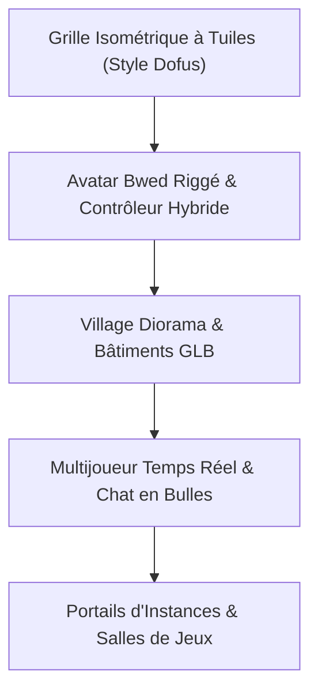

# 🥖 Bwed Village 3D — Game Design Document & Architecture Technique

> **Vision :** Un village social 3D persistant sur navigateur, combinant la grille isométrique tactique à la *Dofus / Wakfu*, le charme diorama de *Zelda Link's Awakening / Animal Crossing*, un avatar Bwed animé, du multijoueur chill en temps réel avec chat en bulles au-dessus des têtes, et des portes vers des mini-jeux instanciés.

---

## 🧭 L'Angle d'Attaque : 5 Piliers Fondateurs



---

## 🧱 Pilier 1 : Le Moteur de Grille Isométrique (L'Esprit "Dofus")

### 1.1 Le Système de Tuiles (Tile Grid System)
* **Système de coordonnées :** Grille discrète `(x, z)` avec niveaux d'élévation `y` (hauteurs 0, 1, 2 pour les falaises et terrasses de gaufrette).
* **Tuiles modulaires (InstancedMesh Three.js) :**
  * `Tile_Cobble_Sable` : Pavés sablés de la grand-place et des rues principales.
  * `Tile_Matcha_Grass` : Pelouse moelleuse en génoise matcha.
  * `Tile_Waffle_Plaza` : Dalles de gaufre caramélisée des terrasses de café.
  * `Tile_Choco_Canal` : Canaux d'eau/chocolat liquide (infranchissables sans pont).
  * `Tile_Wood_Plank` : Pontons et terrasses en bois de planche à découper.
* **Avantage de performance :** Les tuiles sont rendues via un ou deux `InstancedMesh` uniques. Zéro chute de framerate, 60 FPS garantis même avec 5 000 tuiles affichées !

### 1.2 Déplacement & Pathfinding
* **Curseur de tuile interactif :** Survoler le sol affiche une case dorée pulsante sous le curseur de la souris (exactement comme dans Dofus / Tactics).
* **Pathfinding A* sur grille :**
  * Clic sur n'importe quelle case marchable = calcul instantané du chemin le plus court évitant les bâtiments, arbres, barrières et canaux.
  * L'avatar suit le tracé des tuiles avec rotation fluide vers la prochaine case.
* **Double contrôle au choix :**
  1. *Point & Click à la souris / tactile* (style Dofus / Diablo).
  2. *Contrôles directs ZQSD / Flèches / Stick virtuel mobile* (style Animal Crossing / Zelda) pour ceux qui préfèrent diriger leur Bwed au pad.

---

## 🏃 Pilier 2 : L'Avatar Bwed Riggé & Animation

### 2.1 Spécification de l'Avatar
* **Modèle canonique :** Bwed naked avec sneakers rouges (hauteur 1.2 unité de grille).
* **Squelette & Rigging :**
  * `Root` -> `Hips` -> `Spine` -> `Head` (corps tranche de pain souple).
  * `Leg_L / Leg_R` -> `Shoe_L / Shoe_R` (jambes fines, grosses baskets rouges).
  * `Arm_L / Arm_R` -> `Hand_L / Hand_R` (bras nouilles expressifs).
* **Animations clés indispensables :**
  1. `Idle` : Respiration subtile avec petit rebond de mie.
  2. `Walk / Waddle` : Dandinement iconique avec les chaussures rouges qui claquent le sol.
  3. `Run` : Course pressée avec bras en arrière et miettes qui volent.
  4. `Sit` : S'asseoir sur un banc ou un bord de trottoir biscuit.
  5. `Wave / Emote` : Faire un coucou de la main aux autres joueurs.

---

## 🏘️ Pilier 3 : Le Village Diorama & Intégration des Assets 3D

### 3.1 Carte du Village (Level Design Initial)
Le village s'organise autour d'une **Place Centrale** circulaire avec des quartiers thématiques :
* **La Grand-Place de la Moka :**
  * Centre : La Fontaine Cafetière Moka ([`08-espresso-fountain-plaza.jpg`](../01_CANON_BWED/05_BUILDINGS_CONCEPTS/08-espresso-fountain-plaza.jpg)) qui coule du chocolat chaud.
  * Nord : L'Hôtel de Ville / Le Grand Four ([`grand-oven-hq.glb`](../07_3D_MODEL/buildings/)).
* **Le Quartier Gourmand (Est) :**
  * La Pâtisserie du Croissant d'Or ([`patisserie-coin.glb`](../07_3D_MODEL/buildings/patisserie-coin.glb)).
  * Le Kiosque Tasse de Thé & Macarons ([`teacup-gazebo-park.glb`](../07_3D_MODEL/buildings/teacup-gazebo-park.glb)).
  * La Taverne du Pot de Miel ([`honey-pot-tavern.glb`](../07_3D_MODEL/buildings/honey-pot-tavern.glb)).
* **Le Quartier Résidentiel & Services (Ouest) :**
  * Résidence Brique de Lait ([`milk-carton-apartments.glb`](../07_3D_MODEL/buildings/milk-carton-apartments.glb)).
  * Apothicaire Pot de Confiture ([`jam-jar-apothecary.glb`](../07_3D_MODEL/buildings/jam-jar-apothecary.glb)).
  * Salon de Coiffure Chantilly ([`shop-barber-chantilly.glb`](../07_3D_MODEL/buildings/shop-barber-chantilly.glb)).
* **Le Quartier Arcade & Magie (Nord-Est) :**
  * Borne Arcade Géante ([`arcade-duel.glb`](../07_3D_MODEL/buildings/arcade-duel.glb)).
  * Observatoire du Mage ([`portal-observatory.glb`](../07_3D_MODEL/buildings/portal-observatory.glb)).
  * Autos-tamponneuses Donut ([`ride-bumper-cars-donut.glb`](../07_3D_MODEL/buildings/ride-bumper-cars-donut.glb)).

### 3.2 Ambiance & Éclairage Cosy
* Éclairage principal chaud (soleil doré à 45° projetant de douces ombres portées).
* Cycle jour/nuit optionnel : le soir, les lampadaires cuillères s'allument avec une lueur ambrée et les vitrines des boutiques rayonnent.

---

## 💬 Pilier 4 : Multijoueur & Chat Chill en Temps Réel

### 4.1 Architecture Réseau Ultra-Légère
* **Technologie :** WebSockets via un serveur de salon léger (PartyKit, Node.js + `ws`, ou Supabase Realtime).
* **Données synchronisées (par joueur) :**
  ```json
  {
    "id": "player_892",
    "name": "BwedMaster",
    "skin": "glow-toast",
    "x": 14.5,
    "z": 22.0,
    "rot": 1.57,
    "state": "walk",
    "msg": "Venez tous à la fontaine !"
  }
  ```
* **Interpolation fluide (Dead Reckoning / Lerp) :** Les autres joueurs se déplacent de façon fluide à 60 FPS sans à-coups réseau.

### 4.2 Système de Bulles de Chat "À la Dofus / Habbo"
* Lorsqu'un joueur écrit dans la barre de chat inférieure :
  1. Une bulle de dialogue cartoon avec queue orientée vers sa tête apparaît au-dessus de son Bwed en 3D (`CSS2DRenderer` ou sprite billboard).
  2. La bulle reste visible 5 secondes avec animation pop-in douce, puis s'estompe.
  3. L'historique reste lisible dans un panneau de log discret en bas à gauche de l'écran.
* Possibilité d'envoyer des émotes expressives (cœur, miette, rire, GG, wave).

---

## 🚪 Pilier 5 : Portails d'Instances & Intégration des Mini-Jeux

### 5.1 Zones de Déclenchement (Door Triggers)
* Devant chaque bâtiment remarquable, une dalle paillasson lumineuse indique l'entrée :
  * **Entrée dans l'Arcade BwedWare :** Déclenche un menu d'instance avec choix du mode (Solo, Défi amical 1v1 ou Rush en groupe).
  * **Entrée dans l'Hôtel de Ville (Le Grand Four) :** Ouvre une table pour lancer une partie de *Crumb Run 3D*.
  * **Entrée dans la Boutique (Galeries) :** Ouvre le catalogue d'objets cosmétiques pour personnaliser son Bwed.
  * **Entrée dans la Taverne du Pot de Miel :** Instance intérieure intimiste avec jukebox interactif et mini-jeux de cartes/dés sur table.

---

## 🛠️ Plan d'Exécution par Étapes (Roadmap)

```text
[Phase 1 : Socle Isométrique]  ──> Moteur Three.js + Grille de tuiles Dofus + Clic-to-move A*
[Phase 2 : Prototype Avatar]    ──> Intégration Bwed riggé avec animations waddle & idle
[Phase 3 : Map Village 3D]      ──> Disposition des 12 bâtiments GLB + props + lampadaires
[Phase 4 : Réseau & Chat]       ──> Serveur WebSockets + bulles de chat au-dessus des têtes
[Phase 5 : Hub de Mini-Jeux]    ──> Triggers de portes + intégration des instances
```
