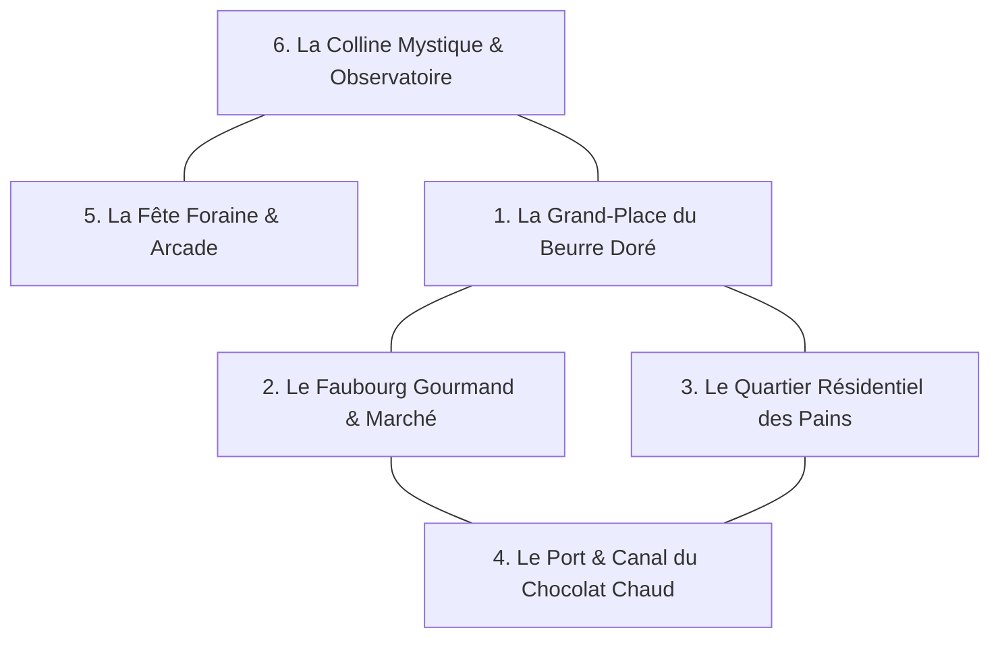

# 🏰 Le Grand Bwed Village — Master Plan & Nouveaux Prompts 3D

Ce document dresse le **plan d'urbanisme complet du village** (intégrant l'ensemble des concepts visuels et modèles 3D existants) ainsi qu'une **sélection de 10 nouvelles idées d'assets incontournables** avec leurs prompts optimisés pour la génération d'images et la conversion en assets 3D `.glb`.

---

## 🗺️ Le Master Plan des 6 Quartiers Thématiques

Le village est conçu comme une grande île-diorama vivante découpée en 6 zones interconnectées par des pavés sablés et des ponts gourmands :



### 1. La Grand-Place du Beurre Doré (Cœur du Village)
* **Centre :** La Fontaine Monumentale Cafetière Moka ([`08-espresso-fountain-plaza.jpg`](../01_CANON_BWED/05_BUILDINGS_CONCEPTS/08-espresso-fountain-plaza.jpg)) versant son chocolat chaud dans un bassin de porcelaine.
* **Nord :** La Mairie & Grand Four ([`grand-oven-hq.glb`](../07_3D_MODEL/buildings/)), siège des décrets communaux.
* **Est :** La Banque aux Miettes ([`03-bwedbank-vault.jpg`](../01_CANON_BWED/05_BUILDINGS_CONCEPTS/03-bwedbank-vault.jpg)) avec son coffre beurrier doré.
* **Mobilier :** Lampadaires cuillères de laiton ([`25-lamp-teaspoon-lantern.jpg`](../01_CANON_BWED/05_BUILDINGS_CONCEPTS/25-lamp-teaspoon-lantern.jpg)), bancs en gaufrettes chocolat ([`26b-bench-chocolate-wafer.jpg`](../01_CANON_BWED/05_BUILDINGS_CONCEPTS/26b-bench-chocolate-wafer.jpg)), pigeons-miettes qui picorent.

### 2. Le Faubourg Gourmand & Marché (Quartier Artisanal)
* **Boutiques intégrées :**
  * La Pâtisserie du Croissant d'Or ([`patisserie-coin.glb`](../07_3D_MODEL/buildings/patisserie-coin.glb)).
  * L'Apothicaire Pot de Confiture ([`jam-jar-apothecary.glb`](../07_3D_MODEL/buildings/jam-jar-apothecary.glb)).
  * La Taverne du Pot de Miel ([`honey-pot-tavern.glb`](../07_3D_MODEL/buildings/honey-pot-tavern.glb)).
  * Les Galeries de Mode & Power-Ups ([`galeries-boutique.glb`](../07_3D_MODEL/buildings/galeries-boutique.glb)).
  * La Halle Marchande Boîte à Œufs ([`16-egg-carton-market.jpg`](../01_CANON_BWED/05_BUILDINGS_CONCEPTS/16-egg-carton-market.jpg)).
  * L'Atelier du Barbier Chantilly ([`shop-barber-chantilly.glb`](../07_3D_MODEL/buildings/shop-barber-chantilly.glb)).
* **Ambiance :** Stores rayés rouges et blancs, étals de brioches, arômes de café moulu, PNJ Toaster-Bot marchand ([`npc-shopkeeper-toaster-bot.glb`](../07_3D_MODEL/buildings/npc-shopkeeper-toaster-bot.glb)).

### 3. Le Quartier Résidentiel des Pains (Quartier Cosy)
* **Habitations :**
  * Immeuble Brique de Lait & Wafer-Boxes ([`milk-carton-apartments.glb`](../07_3D_MODEL/buildings/milk-carton-apartments.glb)).
  * Cottages Toast & Toit Toasté ([`00-cottage-toaster-bakery.jpg`](../01_CANON_BWED/05_BUILDINGS_CONCEPTS/00-cottage-toaster-bakery.jpg)).
  * Moulin à Farine Moulin à Poivre ([`14-pepper-mill-windmill.jpg`](../01_CANON_BWED/05_BUILDINGS_CONCEPTS/14-pepper-mill-windmill.jpg)).
* **Jardins & Nature :** Arbres briochés cannelle & pistache ([`27-tree-brioche-pistachio.jpg`](../01_CANON_BWED/05_BUILDINGS_CONCEPTS/27-tree-brioche-pistachio.jpg)), boîtes aux lettres grille-pain ([`47-prop-mailbox-breadbox.jpg`](../01_CANON_BWED/05_BUILDINGS_CONCEPTS/47-prop-mailbox-breadbox.jpg)), clôtures en bretzel tressé.

### 4. Le Port & Canal du Chocolat Chaud (Façade Maritime)
* **Bassin & Rives :**
  * Quai en bâtonnets d'esquimau ([`80-terrain-pier-popsicle-dock.jpg`](../01_CANON_BWED/05_BUILDINGS_CONCEPTS/80-terrain-pier-popsicle-dock.jpg)).
  * Pont Arqué Rouleau à Pâtisserie ([`21-rolling-pin-bridge.jpg`](../01_CANON_BWED/05_BUILDINGS_CONCEPTS/21-rolling-pin-bridge.jpg)).
  * Phare Saupoudreuse à Sucre Glace ([`17-sugar-shaker-lighthouse.jpg`](../01_CANON_BWED/05_BUILDINGS_CONCEPTS/17-sugar-shaker-lighthouse.jpg)).
* **Flotte :** Gondoles tartelettes aux fraises ([`37-boat-tartlet-gondola.jpg`](../01_CANON_BWED/05_BUILDINGS_CONCEPTS/37-boat-tartlet-gondola.jpg)), Sous-marin viennois ([`108-vehicle-submarine-viennois.jpg`](../01_CANON_BWED/05_BUILDINGS_CONCEPTS/108-vehicle-submarine-viennois.jpg)), Ballon dirigeable soufflé chaud ([`36-airship-souffle-balloon.jpg`](../01_CANON_BWED/05_BUILDINGS_CONCEPTS/36-airship-souffle-balloon.jpg)).

### 5. La Fête Foraine & Arcade BwedWare (Quartier Ludique)
* **Attractions & Salles de Jeux :**
  * Borne-Bâtiment Arcade BwedWare ([`arcade-duel.glb`](../07_3D_MODEL/buildings/arcade-duel.glb)).
  * Autos-tamponneuses Donut Glacé ([`ride-bumper-cars-donut.glb`](../07_3D_MODEL/buildings/ride-bumper-cars-donut.glb)).
  * Manège Chaises Volantes Bretzel ([`105-ride-swing-carousel-pretzel.jpg`](../01_CANON_BWED/05_BUILDINGS_CONCEPTS/105-ride-swing-carousel-pretzel.jpg)).
  * Grand Huit Churro Sucré ([`103-ride-roller-coaster-churro.jpg`](../01_CANON_BWED/05_BUILDINGS_CONCEPTS/103-ride-roller-coaster-churro.jpg)).
  * Podium Gâteau de Fête Foraine ([`arcade-podium-tiered-cake.glb`](../07_3D_MODEL/buildings/arcade-podium-tiered-cake.glb)).

### 6. La Colline Mystique & Sanctuaire (Hauts Plateaux)
* **Relief & Monuments :**
  * Falaise en Millefeuille croustillant ([`76-terrain-cliff-millefeuille.jpg`](../01_CANON_BWED/05_BUILDINGS_CONCEPTS/76-terrain-cliff-millefeuille.jpg)).
  * Cascade de Miel Doré ([`78-terrain-waterfall-honey-cliff.jpg`](../01_CANON_BWED/05_BUILDINGS_CONCEPTS/78-terrain-waterfall-honey-cliff.jpg)).
  * Escalier de Gaufrette & Rampe Sucre ([`terrain-stairs-wafer-ramp.glb`](../07_3D_MODEL/buildings/terrain-stairs-wafer-ramp.glb)).
  * Observatoire du Mage & Passerelle Cuivre ([`portal-observatory.glb`](../07_3D_MODEL/buildings/portal-observatory.glb) & [`67-monument-observatory-colander.jpg`](../01_CANON_BWED/05_BUILDINGS_CONCEPTS/67-monument-observatory-colander.jpg)).
  * Volcan de Chocolat Fondant ([`68b-monument-volcano-fondant.jpg`](../01_CANON_BWED/05_BUILDINGS_CONCEPTS/68b-monument-volcano-fondant.jpg)).

---

## 💡 10 Nouveaux Prompts Prêts à Générer (La Boîte à Outils Village)

Voici 10 nouveaux assets inédits pour enrichir la vie du village, avec leurs prompts calibrés pour Midjourney et une conversion 3D sans accroc :

### 1. Le Panneau d'Affichage Municipal (Tablette de Chocolat & Dragées)
*Idéal au centre du village pour afficher les actus, les quêtes et les scores.*
```text
A cute 3D stylized miniature village community bulletin board in the style of PopMart vinyl toys and Zelda Link's Awakening Switch. A charming public announcement board made of a giant glossy dark-chocolate bar backboard with gold-foil edges, framed with warm honey-wood trim, covered in tiny colorful pastel paper notes held by glossy round candy dragée pushpins. Supported by two sturdy cinnamon-stick posts with pretzel scroll brackets, topped with a tiny pitched biscuit roof. Grounded on a small biscuit-cobblestone footing. Isometric 3/4 front hero view, closed watertight compact 3D volume, soft warm bakery studio lighting, pure solid black background (#000000), strictly no text, no letters, no numbers, no floating detached parts.
```

### 2. Le Triporteur de Café & Beurre (Food Truck Rétro)
*Véhicule mobile stationné sur la place du marché.*
```text
A cute 3D stylized miniature vintage three-wheeled delivery scooter cart in the style of PopMart vinyl toys and Zelda Link's Awakening Switch, combining chibi food-architecture with a retro Italian Vespa Ape van. The vehicle has a chubby cream enamel cab with round brass headlights, iconic tiny red rubber tires with golden cookie hubcaps, and a wooden cargo bed carrying a giant shiny espresso moka pot dispenser and three chubby butter pats. Zero sharp edges and soft rounded proportions. Grounded on a small oval cobblestone footing. Isometric 3/4 front hero view, closed watertight compact 3D volume, soft warm bakery studio lighting, pure solid black background (#000000), strictly no text, no letters, no numbers, no floating detached parts.
```

### 3. Le Puits aux Pièces d'Or (Puits Magique Sablé & Sucre)
*Point de ralliement et fontaine à souhaits.*
```text
A cute 3D stylized miniature wishing well in the style of PopMart vinyl toys and Zelda Link's Awakening Switch. A chubby circular stone well built from stacked sugar-dusted shortbread cookies with chocolate mortar, topped with a conical roof made of overlapping golden waffle shingles supported by two rounded cinnamon posts. The interior is filled with a solid relief of sparkling amber honey liquid overflowing with chunky embossed gold bread coins. A brass crank handle is attached on the side. Mounted on a round biscuit base. Isometric 3/4 front hero view, closed watertight compact 3D volume, soft warm bakery studio lighting, pure solid black background (#000000), strictly no text, no letters, no numbers, no floating detached parts.
```

### 4. La Brouette en Pain d'Épices & Sacs de Farine
*Prop de décor rural et de chantier artisanal.*
```text
A cute 3D stylized miniature wooden garden wheelbarrow in the style of PopMart vinyl toys and Zelda Link's Awakening Switch. A plump, chubby wheelbarrow crafted from frosted gingerbread biscuits with white royal icing piping along the edges, rolling on a single thick golden donut wheel with red sprinkles. The cargo bed is piled with three puffy, plump white canvas flour sacks tied with gold twine and a little brass garden trowel tucked beside them. Grounded on a small rounded cookie footing. Isometric 3/4 front hero view, closed watertight compact 3D volume, soft warm bakery studio lighting, pure solid black background (#000000), strictly no text, no letters, no numbers, no floating detached parts.
```

### 5. Clôture en Bretzels Tressés & Portillon Gaufrette (Kit de Jardin)
*Pour délimiter les jardins et terrasses du village.*
```text
A cute 3D stylized miniature village garden fence segment with a gate in the style of PopMart vinyl toys and Zelda Link's Awakening Switch. A charming decorative fence segment formed by three connected chunky twisted salted pretzel posts with golden-brown crust and white salt crystals, connected by horizontal crispy wafer-cookie rails, featuring an adorable little arched swinging gate made of a glazed waffle grid with a tiny brass latch. Grounded on a long rounded matcha-moss strip base. Isometric 3/4 front hero view, closed watertight compact 3D volume, soft warm bakery studio lighting, pure solid black background (#000000), strictly no text, no letters, no numbers, no floating detached parts.
```

### 6. Poubelle Bocal Vintage & Ramasse-Miettes
*Mobilier de rue indispensable pour garder le village propre.*
```text
A cute 3D stylized miniature village street trash bin in the style of PopMart vinyl toys and Zelda Link's Awakening Switch. A chubby vintage glass canning jar repurposed into a street receptacle with a polished brass swing-top lid, mounted on an elegant cast-iron stand. Inside is visible a solid cartoon mass of golden breadcrumbs and candy wrappers through thick amber-tinted glass. Beside the bin leans a miniature broom made of cinnamon straws and a brass dustpan. Grounded on a small round biscuit footing. Isometric 3/4 front hero view, closed watertight compact 3D volume, soft warm bakery studio lighting, pure solid black background (#000000), strictly no text, no letters, no numbers, no floating detached parts.
```

### 7. Le Pique-Nique Nappe Vichy & Panier d'Osier
*Prop de parc et de détente.*
```text
A cute 3D stylized miniature picnic set in the style of PopMart vinyl toys and Zelda Link's Awakening Switch. A plump, rounded red-and-cream checkered gingham picnic cloth spread out on a small matcha-moss mound, centered with an open woven brioche-crust picnic basket overflowing with shiny red apples, a tiny round camembert cheese with crackers, and a ceramic milk bottle. Beside the basket sits a cozy slice of blueberry pie on a porcelain saucer. Solid watertight closed volume. Isometric 3/4 front hero view, soft warm bakery studio lighting, pure solid black background (#000000), strictly no text, no letters, no numbers, no floating detached parts.
```

### 8. Chien-Baguette (Mascotte & Pet du Village)
*Animal de compagnie fidèle qui court après les miettes.*
```text
A cute 3D stylized vinyl collectible toy pet animal in the style of PopMart and Zelda Link's Awakening Switch. An adorable chubby dachshund puppy whose body is a golden crusty French baguette with classic scored cuts on its back, with soft doughy floppy ears, big shiny black cartoon puppy eyes, a glossy button nose, and a little croissant tail wagging happily. Wearing a tiny red leather collar with a shiny brass bread-crumb bell, standing proudly on four stubby little paws. Solid compact closed 3D volume with no thin detached parts, standing on a small round biscuit pedestal base. Front 3/4 hero view, soft studio lighting, pure solid black background (#000000), strictly no text, no letters.
```

### 9. Chat-Brioche (Mascotte Dormeuse sur les Murets)
*Le chat du boulanger qui fait la sieste sur les bancs.*
```text
A cute 3D stylized vinyl collectible toy pet cat in the style of PopMart and Zelda Link's Awakening Switch. An adorable chubby spherical cat curled up in a loaf pose, whose fur and body are shaped like a golden-glazed three-bump braided brioche loaf with shiny butter glaze, two little triangular pastry ears, closed peaceful curved cartoon sleeping eyes, and a cute curled tail tucked against its flank. Wearing a tiny green ribbon bow around its neck. Solid compact closed 3D volume, resting on a small round chocolate-cookie rug base. Front 3/4 hero view, soft studio lighting, pure solid black background (#000000), strictly no text, no letters.
```

### 10. Le Pêcheur de Bonbons (Bwed PNJ au Bord du Canal)
*PNJ installé sur le ponton de glace.*
```text
A cute 3D stylized vinyl collectible toy character in the style of PopMart and Zelda Link's Awakening Switch. An adorable anthropomorphic bread-slice character (Bwed canon design) with rounded golden crust edges, pale cream crumb face, and large shiny black eyes. Wearing a puffy yellow vinyl raincoat, matching yellow fisherman sou'wester hat, and iconic red sneakers. Holding a sturdy bamboo fishing rod held close to the body, with a tiny wooden candy bait bucket sitting on the ground next to its foot. Solid compact closed 3D volume, standing on a small wooden pier plank footing. Front 3/4 hero view, soft studio lighting, pure solid black background (#000000), strictly no text, no letters.
```
